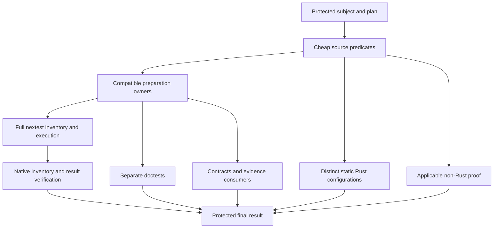

# Qualification rebuild: implementation contracts

Status: proposed design under #14500 / #8198; not installed acceptance.
Delivery plan: [RIPR-PLAN-0064](../../plans/ci-lifecycle-rebuild/implementation-plan.md).
Installed evidence: [current state](current-state.md).

This reference specifies the boundaries that implementations must preserve.
[ProductGatePlan](PRODUCT_GATE_PLAN.md) remains the semantic obligation owner;
[merge flow](../MERGE_FLOW.md) remains the installed request/landing procedure.
Native issues and PRs own live work. This document creates no scheduler, second
queue, artifact registry, approval authority or machine-enforced gate.

## Decisions and remaining experiments

| Subject | Selected direction | What remains to qualify |
| --- | --- | --- |
| Development | Focused local proof and substantive review; no automatic Draft, Ready, synchronize or comment CI, including cheap/skipped wrappers | Complete Actions, Checks and status-publisher perimeter on new and older contexts |
| Merge request | Explicit cheap, trusted, exact-H admission; no product compilation | The source-bound mechanism and truthful check attachment that GitHub actually enforces |
| Queue | GitHub's native queue; actual complete combined G is the product subject | Dynamic native membership, prefix disposition and one heavy execution per accepted group |
| Execution | One obligation plan; prepare once per compatible family; private mutable consumers | Same-runner locality versus a small transported layout, measured end to end |
| Test contract | Current nextest selection/isolation and separate doctests | Any later pure-test batching or affected-test execution needs its own compatibility/policy decision |
| Static Rust | Keep default workspace and all-features RIPR configurations | Reuse only demonstrably compatible compiler work; neither configuration subsumes the other |
| Final result | Protected source and authenticated native producer facts | Native protected workflow first; a narrow App-bound fallback only if needed and separately authorized |
| Cache | Optional acceleration with a complete cold path | Actual producer publication, reader adoption, invalidation and total-route benefit |
| Compute | Under 20 total raw runner-minutes for a normal accepted submission/stack across its merge-group attempts, prefixes, replacements and required preparation; retain the separate under-20 elapsed objective | No target job count, phase-time allocation or saving is assumed from this design |
| Resources | Existing hosted route and existing process/resource owners | Measured per-unit CPU, process-tree memory, disk and queue concurrency |

Eight parallel jobs, one giant build, a new fleet, Hermes, an always-on watcher,
and a cache warmer are not selected prerequisites. Reducing job count is not
itself acceptance. Neither is lowering wall time while increasing total work.

## Source and component ownership

Keep the existing Rust-first, ports-and-adapters boundary. Pure code decides
meaning; narrow adapters perform GitHub, Git, Cargo, process and artifact effects.
YAML declares events, permissions, allocations, dependencies and invocations.
It must not become a second implementation of eligibility or result semantics.

| Concern | Existing owner to extend | Boundary |
| --- | --- | --- |
| Gate meaning and applicability | `xtask/src/product_gate_plan.rs`; staged migration in #13514 | Pure typed plan; preserve canonical IDs and established grouped producers |
| Lightweight policy and executable identity | `tools/repo-policy` | No normal/build dependency on RIPR; old xtask commands delegate |
| Native intake, membership and result binding | Existing #14500 reconstruction; #8082 source/history is reference, not a branch to reactivate | Small capability-specific adapters around the accepted pure contracts |
| Workflow execution | Existing routed/reusable workflows, reconciled through #13514 | Projection of the plan, not an independent obligation list |
| Test identity and reconciliation | Existing native producer and `xtask/src/verify_test_shards.rs` | Exact case/binary cover and authenticated attempt selection |
| Product preparation consumers | #13906 and #13481 / #14493 / #14501 under their existing owners | Cargo-selected binaries/inventory; source-custody hold remains |
| Economics reporting | Existing CI budget/audit reporting under #4841 / #8198 | Native attempt/job facts and derived totals, not a new operational state store |
| Compiler-unit boundaries | ADR 0027 and #12726 / #14199 | Private implementation plus private tests; preserve the public RIPR facade |

Do not copy #13514's staged eight-job placement into production as its
acceptance. Reconcile its plan and projection against current producers first.
Do not recreate its already-owned lightweight-plan extraction.

## Four identities, not one branch SHA

The following are contract fields, not a claim that new Rust types or a new
serialized schema already exist. Extend existing admission/plan/context types
where they own these facts.

| Record | Minimum identity | Reader and refusal |
| --- | --- | --- |
| Admission | Repository and authorized destination; requested ordered PR/H set and dependency edges; reviewed H; request identity; protected control generation C; eligibility evidence | Intake and later currentness checks refuse stale H, unauthorized target, incomplete reads and unresolved review/cut blockers |
| Qualification subject | Actual native G/tree/ref; its protected comparison anchor B0; complete ordered queue composition; relationship to the requested stack; native request/entry identities; C and plan identity | Planning and finalization refuse missing, extra, reordered or unbound members, ambiguous ancestry and a caller-supplied-only subject |
| Prepared product | Subject/input closure; Cargo/rustc/nextest versions; host/target; resolved features; profile/flags/environment; producer execution; Cargo-selected paths and output digests | Consumers refuse incompatibility or corruption before use; a cache hit never supplies execution success |
| Execution evidence | Obligation IDs; producer job and attempt; actual checkout; command/configuration; outcome; inventory; input/output manifest; reuse provenance | Finalizer joins native GitHub facts with the expected plan and refuses missing, failed, incomplete, stale or superseded work |

The request-time destination tip is not automatically B0 for a later G.
GitHub may advance the base or include another speculative prefix. Freeze a
new qualification subject for each actual G; retain unchanged exact-H source
review only at its original scope and re-evaluate current eligibility.

Requested dependency-stack membership and the entire queue composition included
in G are different sets. Record both and their ordered relationship. A native
stack can have a non-main immediate base branch. A ref suffix, queue position,
configured maximum size, or immediate `merge_group.base_sha..head_sha` walk
cannot substitute for complete membership.

Control generation C is independently protected. The event's immediate base
may be an unlanded lower G, and therefore is not automatically C or B0.
Current matcher/admission ancestry checks establish a relationship to G,
not this separate source-authority property.

The requested selection may be only the lower portion of a registered native
stack through the explicitly selected PR. It does not authorize every upper
member. Join provider-reported stack order to each live PR and fetched head;
the complete G may additionally contain an earlier speculative queue prefix.
Retain these three populations instead of calling all of them "the stack".

Every unlanded member included in G must join a matching authenticated exact-H
admission and authorized request under the accepted control generation C.
Native queue membership alone is not admission authority. A missing, revoked,
incompatible-generation or ambiguous admission refuses the complete G, even
when Git composition and current review facts otherwise match. This joins
existing native admission evidence; it does not create a receipt registry.

### Admission and protection meanings

Exact-H admission means the explicit request identifies this current head,
selected native stack and authorized destination and satisfies protected
source/scope/review/eligibility policy. It permits submission to the protected
native queue. It is not product correctness and cannot authorize direct merge.
Read every relevant member's current review/thread/cut state; unchanged H can
acquire a new blocker.

| Evaluation | Installed proposition | Target proposition and enforcement gate |
| --- | --- | --- |
| H / PR integration subject P | Full explicit PR qualification under the current required result | Cheap exact-H admission only after native queue-only landing is enforced |
| Actual G | Full applicable proof and current eligibility | Complete applicable combined-G proof from authenticated protected control |
| M | Native landed readback | Exact qualified-to-landed mapping; no ordinary product replay |

These conceptual propositions do not assume GitHub offers independently
configurable H and G required-context sets. Qualify the actual mapping of
context/workflow requirement, application identity, source generation and
subject under the selected native mechanism before changing protection.

A fresh eligibility read is not an atomic merge lock. Native review requirements
remain provider-enforced. If landing wins an explicit-withdrawal or custom
late-finding race, preserve the actual M outcome and route the incident; do not
report that withdrawal succeeded.

### Snapshot and currentness protocol

1. Read the native request, ordered membership, destination and exact heads
   completely, including pagination. Record native object identities.
2. Reconstruct or independently verify the expected composition/tree and its
   protected anchor. Distinguish source review on H from integration proof on G.
3. Re-read the identities that can move. A changed or partial snapshot is
   retried only within a bounded read; unresolved ambiguity refuses admission.
4. Freeze the subject and control/plan generation before expensive allocation.
   Labels and path selection use the full applicable composition, not the tip PR.
5. Before publication, re-read current native eligibility and producer facts.
   Separate reads are not an atomic merge transaction; native protection still
   governs conditional landing.

This is a bounded transaction in the existing owner. It is not a new service
that continually scans the whole repository.

## Lifecycle and transitions

| Stage | Permitted work | Advance condition | Failure / recovery |
| --- | --- | --- | --- |
| Development | Edit, selected local checks, review, Draft publication | Coherent exact H with material findings addressed | Repair the same candidate; no automatic hosted qualification |
| Explicit admission | Protected metadata/source/plan validation, no product compilation | Current exact-H request and authorized destination | Preserve a typed refusal and return to the owning session |
| Native enqueue | Supported expected-H queue request without bypass | Native acknowledgement binds the request to the accepted object | Unknown/expired acknowledgement is reconciliation work, not permission to enqueue again |
| G formation | Resolve complete composition and freeze B0/G/C/plan | Exact native subject and membership established | Unknown composition cannot allocate a guessed or partial portfolio |
| Product preparation/execution | Complete selected proof with owned resources | All mandatory producers have truthful terminal evidence | Preserve original failure; stop only work that no longer has a valid consumer |
| Finalization | Protected reader validates expected obligations and native executions | Complete compatible evidence plus current eligibility | No success from skipped, missing, cancelled, stale or candidate-created same-name results |
| Protected landing | GitHub performs its authorized queue merge | Native requirements remain satisfied | Ejection/withdrawal/recomposition produces its actual outcome |
| M reconciliation | Read actual landed commit/tree and qualification relation | Native per-member merge identities and final M match the accepted settlement mapping | Report mismatch or uncertainty; do not rerun the suite merely because main moved |

Enqueue authorizes conditional landing; it is not a neutral test button.
The current full `merge-ready` PR qualification remains authoritative until
cheap admission and queue-only landing are jointly qualified and enforced.
No intermediate documentation or source change disables that producer.

The supported native request adapter retains the exact requested top H and
options, explicit queue action and no bypass. Its asynchronous acknowledgement
is not G proof or M. A preexisting-state response, conflicting request, timeout
or expired request identity requires native readback before any second mutation.
The top-H guard is not an atomic guard over all lower heads.

### Native stacks and prefix events

The isolated three-member rehearsal observed three merge-group dispatches but
one heavy complete-G execution, with observation-only handling for the prefixes.
It is useful evidence, not a production contract. HEADGREEN changes required-pass
semantics; it does not promise that prefix events disappear.

For the production design, prefix observation must be distinguishable from
product qualification. A prefix cannot publish a green required product result
because its heavy job was skipped. It must not emit the canonical qualification
as success, neutral or skipped. Use distinct prefix-observation, complete-
candidate, refused and unknown outcomes; only the complete candidate runs
product proof. Inspect actual native context names, including skipped-job
names, rather than assuming a job-level condition removes the context.
Qualify the actual provider enforcement of
the complete group before selecting this route. Retain singleton qualification
and current protection if that enforcement remains unavailable.

A lower prefix landing with the same accepted history is not withdrawal of
the upper G. Removal, changed H, recomposition, or positive native destruction
is different. The liveness contract must decide the exact G's fate, not cancel
every run associated with a PR or a moving main branch.

For the initial SQUASH profile, bind provider-recorded per-member merge commits
to the captured commits in the accepted G chain, and final M to the accepted
complete G. Retain native request/entry and qualification identities with that
mapping. If the provider uses another representation, qualify its mapping
separately before accepting settlement. Equal trees alone cannot settle a
different native request or qualification lifetime.

## Execution graph and conservation

The reference graph separates required meaning from execution placement:

These nodes are propositions and dependencies, not an Actions job-count contract.
First establish a same-runner locality reference using separate commands and
bounded process lifetimes. Then compare a small layout against it. Transport
or splitting is justified only by measured whole-route benefit and preserved
identity, not by the diagram.

The same-runner reference is a measurement choice, not a production worker-count
ruling. Retain the current safe ordering of large workspace compiler units.
Pack runtime consumers beside their prepared artifacts first; split only where
independence, memory headroom and whole-route latency/cost justify it.

### Obligation-to-producer rules

The 13 canonical ProductGatePlan IDs remain. Grouping can share an execution
without deleting its logical obligations:

- `ci-policy` discharges its retained dependency, process and network predicates;
  do not restore three standalone executions to make a staged projector happy.
- `goldens check-with-fixtures` discharges both golden and fixture obligations
  and retains their outputs; do not split it back into duplicate evaluation.
- Default-feature workspace/all-target Clippy retains the already-proved plain
  type-check coverage; do not restore the removed standalone `cargo check`.
- All-features RIPR Clippy remains separate. Default-only cfg branches and
  non-default branches are not interchangeable.
- Full default nextest and workspace doctests remain separate. Optional-feature
  lint compilation is not optional-feature test execution.

The complete qualification plan must also account for installed mandatory
producers outside those 13 IDs: native file-policy inventory, applicable
trusted-base user-text proof, verdict corpora, capability/contract checks,
PR-evidence packet/schema work, applicable extension proof, shard verification,
and admission/final currentness. The existing staged reconciliation owner
must map these to explicit outcomes rather than inventing another registry.

#13514 already has a staged 24-row Rust denominator. In addition to the 13
canonical rows it names workspace preparation, base preparation, two pinned
base-recovery operations, base user text, capability producers, capability
documentation, verdict corpora, PR evidence, schema sweep and wildcard retention.
Preserve the distinction between preparation, assertion execution and required
output retention. These staged rows do not cover the whole docs, extension or
wider selected platform/package portfolio.

The installed docs path directly selects `gh_pr_status_no_settings`,
`ripr_public_guide_contract`, `spec_template_contract`,
`pr_readiness_workflow_contract` and `executable_frontdoor` as well as its
policy obligations. Preserve those asserting readers when replacing its heavy
precommit path. Keep wider callable Rust-only, Perl/identity, platform,
packaging/release and printed-command configurations where selected; do not
silently discard them or newly make all of them unconditional PR requirements.

For each selected obligation, finalization sees exactly one authorized
discharge: executed success, explicitly compatible prior execution, or a
policy-defined not-applicable result. A blocked, unknown or absent obligation
cannot disappear from the denominator. When one producer discharges several
IDs, its failure makes every dependent obligation non-success.

### Build-family boundaries

| Family | Typical consumers | Compatibility requirement |
| --- | --- | --- |
| Protected control | Admission, expected-plan reader and finalizer | Independently accepted C, never a candidate-produced executable |
| Product-free policy | Workflow/agent/source checks and eligible documentation checks | Same policy source/compiler identity; no product-linked default executable |
| Default workspace tests | Nextest cases and compatible native inventory readers | Exact resolved feature graph, test profile, target, flags and runtime inputs |
| Product CLI | Guide/fixture/contract consumers that execute RIPR | Cargo-selected binary for the intended source/profile/features; no ambient PATH discovery |
| Default static Rust | Workspace/all-target Clippy | Preserve its compiler units and flags; do not assert equivalence from package names |
| All-feature static Rust | RIPR all-target/all-feature Clippy | Separate feature family unless native unit compatibility is demonstrated |
| Rustdoc | Workspace doctests | Preserve rustdoc/toolchain/features and required execution |
| Trusted-base policy | B/C-owned matcher judging candidate inputs | Protected source provenance is separate from candidate identity |

Package-only and workspace-unified native inventories can differ. A matching
number of tests or identical names do not establish compatible features.
Reuse the exact native inventory where compatible; prepare the distinct family
where it is not. Never replace native enumeration with source scanning.

Record Cargo compile profile and nextest execution profile separately.
`nextest --profile ci` is an execution-policy selection, not evidence that
Cargo used a profile named ci. Current hosted `CARGO_PROFILE_DEV_DEBUG=0` and
other effective flags belong in compatibility; a staged validator that rejects
all profile overrides must be reconciled, not used to erase installed behavior.

## Prepared artifacts, caches and mutable state

The preparation owner captures Cargo's selected artifact path and actual
build context. It supplies a sealed output manifest plus the native test/binary
inventory when applicable. A consumer verifies admission once, borrows the
immutable prepared product, owns its writable scratch, and returns an outcome
bound to that product. Final ownership verification occurs after all descendants
that could write have terminated and been reaped.

Keep three products separate:

1. Dependency/compiler caches: acceleration inputs, never evidence of success.
2. Prepared executables and inventories: compatible executable inputs, not
   evidence that required assertions ran.
3. Successful execution evidence: a native producer result under the qualified
   subject/configuration/attempt contract.

The transfer envelope must reject missing entries, digest/configuration
mismatch, unexpected paths and incomplete inventory. Treat downloaded paths,
symlinks and executable permissions as an input boundary; extraction must remain
inside its owned destination and preserve only explicitly needed metadata.
An artifact name or a checksum supplied by the same untrusted producer does not
authenticate that producer.

Do not share mutable Cargo target, report, socket, port, fixture or temporary
directories between concurrent owners. Give one CPU/memory/disk budget to the
whole execution unit, including nested Cargo, tests and cleanup. Cache
enablement must not accidentally permit a second overlapping compiler graph.

The cold path starts without the reusable product and must succeed or report
its real failure within its declared budget. Distinguish not attempted, miss,
partial/incompatible restore, usable restore, rejected restore and rebuild.
Charge archive generation, upload, transfer, extraction, verification and every
consumer. The rejected multi-gigabyte archive and #13906's over-deadline cold
preparation are retained counterexamples, not accepted prerequisites.

In CI, a miss returns to the single preparation owner for that compatible
family. Consumers must not each fall back to Cargo and recreate the independent
builds this design removes. A missing required producer remains blocked/failed
until its supported retry supplies valid preparation. Standalone local
fallback is a different mode, explicitly reported and separately qualified.

## Documentation, fixtures and analysis

Reader-aware classification precedes route selection. Markdown used by CLI
help, command-example, agent, adapter or printed-command tests retains those
behavioral consumers. Unknown or mixed readers widen required proof. A policy
file can change execution semantics; its suffix does not make it cheap.

The `cargo policy docs-gate` interface exists but does not cover every current
required documentation obligation. Move eligible semantic owners one at a time,
retain xtask facades, demonstrate verdict/report parity, then adopt the actual
command. #15177 is the document-role leaf; it is not docs-route activation.

The product-free `check-user-text --tree` front door and its workflow consumer
already exist. Modern eligible bases use it; older bases retain the xtask
fallback. Do not assign that extraction again. The remaining multi-member
question is whether the selected base is actually protected C/B0; the current
event-base ancestry checks alone do not establish that.

Guide tests should borrow a validated CLI instead of invoking Cargo from every
nextest process. A process-local OnceLock does not share preparation across test
processes. Tests whose subject is build/install/compiler behavior keep their
private bounded build. Preserve nextest isolation initially; any pure batching
experiment needs state-contamination and per-case-result controls.

Separate mandatory evidence integrity from costly analysis inside PR-evidence
production. Reuse exact-source facts where their contract permits; preserve
schema, denominator and refusal checks. An honest unavailable analysis is not
a saving, and moving currently required analysis to advisory work requires an
explicit policy decision.

## Attempt, failure and retirement contracts

| Observation | Permitted action | Forbidden inference |
| --- | --- | --- |
| Required producer fails deterministically | Retain failure/diagnostics; stop and reap dependents and now-unnecessary same-subject work | Retry unchanged until green or rename it a flake |
| Infrastructure interruption | Diagnose and use the supported bounded recovery for that producer | Reuse a stale result because the artifact still exists |
| Finalizer fails after valid producers | Reconcile fresh native job facts and current eligibility; reuse only under a qualified finalizer-only contract | Claim whole-route partial-rerun support from shard-artifact support alone |
| Newer producer fails or is cancelled without uploading | Native execution facts supersede older evidence according to the explicit attempt policy | Search backward for the newest available green artifact |
| Same H, new G | New qualification subject; preserve only applicable H-bound source review | Relabel old integration evidence as new-G proof |
| Main advances or another run starts | Reconcile the exact G lifetime | Broad cancellation keyed by main or PR |
| Lower prefix settles | Distinguish successful settlement from withdrawal/recomposition | Assume every upper G is obsolete |
| Positive exact-G retirement | Cancel only that retired lifetime and reap owned descendants | Cancel a replacement or valid speculative sibling |
| Native read is partial, unavailable or ambiguous | Unknown; no success and no invented retirement | Treat absence in a failed read as deletion |

Admission transaction, producer attempt and finalizer attempt have distinct
identities. Retain the current run-attempt admission binding until its
replacement is qualified. A policy for accepted earlier producer evidence must
name same-run/cross-run scope, supersession, configuration, disclosure and
current eligibility; default to refusal where it is unspecified.

The initial proposed successful-evidence reuse scope is same repository/run,
exact G, C, plan and proof configuration, with no later superseding producer.
Cross-run successful-result reuse is not part of this first cutover. Read every
relevant attempt and job page; a latest-attempt first page or artifact listing
alone cannot establish the absence of a later failed execution.

Finalizer-only recovery must exercise all of these transitions: complete old
producers plus a failed finalizer; later producer failure with no artifact;
missing native job pages; expired/corrupt evidence; changed C/plan; forged
same-name success; and an uncertain publication response. The last case retains
the returned check/request identity where available and reconciles native state
before retry. A late older finalizer cannot overwrite a newer refusal.

Prefer bounded in-job liveness checks before expensive phases, with a read-only
watchdog only where long-running work warrants it. A protected exact-run
reconciler is optional if queued/sibling work cannot otherwise be reclaimed.
GitHub cancellation names a run, not one attempt; cancel the whole run only
when its whole lifetime is retired. There is no Actions `merge_group: destroyed`
activity type to build this on.

Do not rely solely on `workflow_run: requested` to observe reruns; that event
does not cover them. Recovery must read the actual attempt/job state through
the supported native interface.

## Trust and external-provider perimeter

Keep candidate execution unprivileged. It receives no publisher credential,
queue mutation authority, deployment secret or release authority. The finalizer
reads native producer/job facts and candidate evidence as data; it must not run
candidate scripts, local actions or cache payloads to decide protected success.

Pin the complete transitive trusted source closure, including called workflows,
local actions and invoked controller code. Reject candidate changes that omit
the trusted callee or spoof its context name. An Actions application ID alone
does not distinguish two workflows published by that same application.
An automatic workflow_dispatch check belongs to its dispatch ref; checking out
H does not reattach it to H. Attachment and authentication are separate tests.

The merge-group-only organization-workflow validator rejection is a reproduced
provider/documentation mismatch recorded under #14500. Do not add a forbidden
PR trigger or the unsupported `merge_queue` event string to get around it.
Keep the current result until a native protected-source mechanism, or an
independently authorized narrow publisher fallback, passes the actual controls.

Inventory Actions starts, check runs, check suites and commit statuses
separately. A placeholder or neutral result is not measured allocated work.
External secret scanning may cover constituent commit history; a secret added
and removed before the final G tree must not disappear from the replacement
scan scope. No integration is disabled as a side effect of the CI redesign.

## Acceptance ladder and rollout

The concrete [native acceptance matrix](../../plans/ci-lifecycle-rebuild/implementation-plan.md#native-acceptance-matrix)
assigns expected outcomes to the lifecycle counterexamples. It is prospective
proof, not authorization to execute those canaries in production.

| Gate | Evidence required | What it does not authorize |
| --- | --- | --- |
| Source contract | Literal inventories, actual consumers, normal and wrong-input controls, full required-outcome conservation | Hosted or installed success |
| Focused execution | Real Git/CLI/OS behavior on the exact candidate, plus the old/wrong implementation witness where applicable | Whole-route economics |
| Native consumer | Actual checkout/controller/feature identity, nonempty results and producer-to-consumer use | Settings cutover |
| Integrated qualification | Complete actual-G portfolio, cold correctness, failure propagation, attempts and total work | Claiming all future groups meet a universal SLA |
| Isolated lifecycle | Singleton, two-/three-member stack, bad-middle, spoofing, recomposition, settlement, failure and rollback controls | Production activation |
| Protected activation | Separately authorized coherent source/settings transaction, live readback and reachable rollback | Declaring the target from one favorable run |
| Operating cohort | Existing #14500 twenty-admission cohort, all starts/outcomes and complete economics, including older contexts | Excluding failed/replaced work or unmeasured publishers |

The [recorded acceptance clarification](https://github.com/EffortlessMetrics/ripr-swarm/issues/4841#issuecomment-6999978169)
binds the under-20 raw-runner-minute objective to the normal accepted submission
or stack, not merely its final successful G. Sum all associated merge-group
attempts, runner-allocating prefix observations, retries/replacements and
causally required preparation, transport and finalization. Keep exact-G totals
as diagnostics and report the stack total alongside its landed-PR count; do not
divide by PR count to hide an expensive stack. Two 2-minute prefixes plus a
19-minute complete G cost 23 minutes and fail this target. The separate under-20
qualification-elapsed objective runs from the first associated qualification
allocation to the complete result without resetting on retry or replacement.
Report enqueue-to-result and enqueue-to-landing separately; this does not create
a universal under-20 queue-delay or landing SLA.
Cheap H/control work and unsuccessful submissions also remain explicit in
lifecycle totals. Missing attribution or native pages leaves acceptance unknown.

Use existing observations before new benchmarks. Select one discriminating
candidate, run focused controls, and use its ordinary necessary qualification.
A dedicated performance comparison needs explicit matched inputs and a bounded
experiment; five paired cache replays are not a five-full-CI-runs rule.

The implementation sequence has two join points:

1. Land independent semantic/preparation/compiler corrections through current
   protection. Keep ownership and custody holds intact.
2. Reconcile #13514's executable plan and current producers; qualify the
   selected complete execution layout without weakening required outcomes.
3. In parallel, qualify dynamic native subject identity and protected admission/
   finalization. Compute improvements and lifecycle correctness are distinct.
4. Install the protected successor in a non-authoritative isolated/evaluation
   scope when authorized; demonstrate positive and negative enforcement.
5. Apply one reviewed source/settings generation only after the successor is
   reachable. Current full PR qualification remains until cheap H admission
   cannot authorize direct landing.
6. Retire the remaining label/bootstrap edges and reconcile old contexts.
   Keep release/security/incident/deep purposes separately owned.
7. Observe the operating cohort and reconcile actual M. Accept each enabling
   improvement at its earned strength; keep the parent open until the integrated
   lifecycle, required portfolio and total-work target are met.

Rollback pauses new admission, classifies in-flight Gs, restores and verifies
the previous complete qualification route, then removes successor enforcement
only when the previous route is reachable. Preserve deletion/non-fast-forward/
thread protections and unrelated rules. Never leave cheap H as the only gate
for direct landing. A rollback that needs new settings authority pauses for it.

## Implementation and review style

- Extend the real semantic owner; avoid parallel parsers, command inventories
  or a large generic script that recreates the workflow in another language.
- Use explicit states for success, failure, not applicable, blocked and unknown;
  no catch-all boolean or empty collection should manufacture success.
- Keep typed pure decisions separate from I/O. Add a port only where a real
  effect or independent wrong-input test needs it, not for an imagined framework.
- Keep commands and their feature/profile/target semantics inspectable. Grouped
  execution retains each logical outcome; reports do not substitute for exit and
  native producer facts.
- Errors name the failed obligation, subject and actionable stop reason.
  Preserve the original failure through cleanup and finalization.
- Tests use independent literal expectations, nonempty inventories, meaningful
  old/wrong implementations and the actual production entrypoint. Source-string
  assertions are supplemental, not native behavioral proof.
- Each PR names one production behavior or architectural seam, its consumers,
  proof, economics and bounded rollback. Include necessary docs/fixtures in
  that slice; do not split only to reduce line count.
- Source, focused proof, native use, installed activation and operated economics
  are separate states. Preserve missing evidence rather than relabel it.

See [CI actuals](ci-actuals.md) for the accounting contract and
[the implementation plan](../../plans/ci-lifecycle-rebuild/implementation-plan.md)
for the existing owners, candidate dependencies and specific proof commands.

## Source anchors for the design

- [Native stack membership API](https://docs.github.com/en/rest/pulls/stacks)
  and [asynchronous queue request/result API](https://docs.github.com/en/rest/pulls/pulls#merge-a-pull-request-asynchronously):
  requested downstack selection, exact-head options and acknowledgement limits.
- [Native workflow job inventory](https://docs.github.com/en/rest/actions/workflow-jobs):
  complete pages and all executions, not a default latest-attempt-only view.
- [Workflow events](https://docs.github.com/en/actions/reference/workflows-and-actions/events-that-trigger-workflows#workflow_run):
  source/privilege boundary and the requested-event rerun limitation.
- [Current routed source](https://github.com/EffortlessMetrics/ripr-swarm/blob/73a5ff3f73b65784d249db07839a0596c287318f/.github/workflows/routed-rust.yml)
  and [inspected Rust gates](https://github.com/EffortlessMetrics/ripr-swarm/blob/0c058d5179586b04ad1f0e874608757d7e7f0829/.github/workflows/rust-gates.yml):
  installed behavior and remaining immediate-base assumptions.
- [Existing staged plan/projection](https://github.com/EffortlessMetrics/ripr-swarm/pull/13514):
  current owner, not a new implementation invitation or accepted placement.
- [#8082 reference-only disposition](https://github.com/EffortlessMetrics/ripr-swarm/pull/8082#issuecomment-6571880146),
  [native stack rehearsal](https://github.com/EffortlessMetrics/ripr-swarm/issues/4841#issuecomment-6981171139),
  and [provider validator reproduction](https://github.com/EffortlessMetrics/ripr-swarm/issues/14500#issuecomment-6983589778):
  preserve the actual scope of each result.
